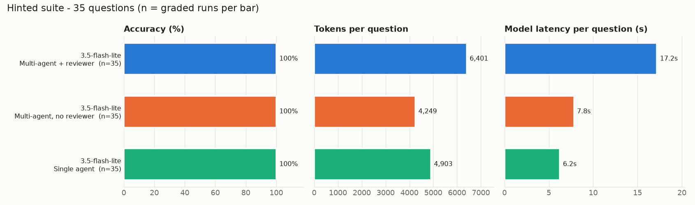
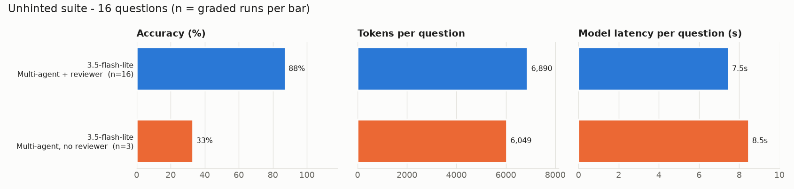

# Autonomous Data Analyst

A multi-agent system that answers business questions about messy spreadsheets. Upload a CSV or
Excel file and ask *"Why did West revenue drop in Q3?"*. A team of LangGraph agents then:

1. **profiles** the data (types, missing values, numbers stored as text, outliers…),
2. **plans** the analysis (optionally pausing for your approval),
3. **writes pandas code** and runs it in a **sandbox**,
4. **fixes its own errors** when the code fails,
5. has a **reviewer** check the logic and numbers, and
6. writes a **Markdown report with charts**, using only numbers the code actually printed.

It comes with a FastAPI backend, a Streamlit UI, an MCP server, a 35-question evaluation
with deterministic grading, and experiments comparing single- and multi-agent setups.

```
profile → planner → [you approve?] → coder → executor → reviewer → reporter
                                       ▲  fix ≤3 │         │ revise ≤2
                                       └─────────┴─────────┘
```

## Quick start

```bash
# Python 3.11+ (developed on 3.12)
uv venv --python 3.12 .venv && source .venv/bin/activate   # or: python -m venv .venv
pip install -r requirements.txt
cp .env.example .env          # then put your GEMINI_API_KEY in .env (free key: https://aistudio.google.com)
```

**Command line**

```bash
python -m analyst.runner "Which region had the biggest revenue drop from Q2 to Q3?" data/sales.csv
python -m analyst.runner "What drives attrition?" data/hr_employees.xlsx --approve          # review the plan first
python -m analyst.runner "Which channel converts best?" data/web_traffic.csv --variant single
```

**Web app**

```bash
uvicorn api.main:app --port 8000      # terminal 1 - API docs at http://localhost:8000/docs
streamlit run ui/app.py               # terminal 2 - http://localhost:8501
```

or with Docker: `docker compose up --build`.

**From Python**

```python
from analyst.runner import run_analysis
res = run_analysis("Which agent resolves tickets slowest?", ["data/support_tickets.csv"])
print(res.answer)          # one-line answer
print(res.report_path)     # outputs/<run_id>/report.md (+ chart_N.png, analysis.py)
print(res.metrics)         # llm_calls, tokens, cost_usd, latency, retries...
```

## MCP server

Exposes the analyst to MCP clients such as Claude Desktop, Claude Code or an IDE:

| Tool | What it does |
|---|---|
| `list_datasets` | datasets in `data/` and `uploads/` |
| `profile_dataset` | columns, dtypes, missing values, data-quality notes |
| `run_python` | run pandas/matplotlib code in the sandbox |
| `ask_analyst` | the full multi-agent analysis → answer, report, chart paths, metrics |

Claude Desktop (`claude_desktop_config.json`):

```json
{
  "mcpServers": {
    "data-analyst": {
      "command": "/path/to/data-analyst-agent/.venv/bin/python",
      "args": ["-m", "analyst_mcp.server"],
      "cwd": "/path/to/data-analyst-agent"
    }
  }
}
```

Claude Code: `claude mcp add data-analyst -- /path/to/.venv/bin/python -m analyst_mcp.server`
(run it from the project directory). For HTTP transport: `python -m analyst_mcp.server --http --port 8001`.

## Experiments

All runs use `gemini-3.5-flash-lite` on the free tier. Full tables are in [results/summary.md](results/summary.md),
and every raw run is in `results/runs.jsonl`.

**Hinted suite (35 questions, cleaning rules stated in the question): every variant scored 35/35.**

| Variant | Accuracy | LLM calls / question | Tokens / question |
|---|---|---|---|
| Multi-agent + reviewer | 100% | 4.0 | 6,401 |
| Multi-agent, no reviewer | 100% | 3.0 | 4,249 |
| Single agent | 100% | 2.4 | 4,903 |



**Unhinted suite (the 16 questions whose data-error hints were removed: the agents must notice the
999-unit orders, ×10 salary typos and invalid resolution times on their own).**

| Variant | Graded runs | Accuracy |
|---|---|---|
| Multi-agent + reviewer | 16 / 16 | 88% (14/16) |
| Multi-agent, no reviewer | 3 / 16 | 33% (1/3) |
| Single agent | 0 / 16 | – |



What the numbers show, and what they don't:

- **When the task is fully specified, the extra agents add cost, not accuracy.** On the hinted suite the
  single agent was as accurate as the full team with ~40% fewer LLM calls.
- **Messy data is where the pipeline earns its keep, but this run can't yet say which part matters.** With hints
  removed, the full pipeline still got 14/16. Both no-reviewer failures (of 3 graded) were the 999-unit outlier
  trap (*"North fell 76.6%"*). However, the reviewer requested **zero** revisions in these runs, so the difference
  can't be credited to it. More likely it comes from run-to-run variation in whether the Planner includes outlier
  removal, on a very small sample.
- **The unhinted comparison is incomplete.** The free tier allows 500 requests/day for this model, and the quota ran
  out partway through, so 24 runs were never graded (they are counted as `infra_errors`, not as wrong answers).
  To finish it after the quota resets:
  `python -m eval.harness --variants no_reviewer single --suite unhinted && python -m eval.report`.
- **The second-model comparison is not done.** `gemini-3.5-flash` allows only 20 requests/day, and the other
  models were overloaded (HTTP 503) or retired (404) at run time. Use `--models` with any model you have quota for.
- Latency: the multi-agent hinted batch ran first, while the API was slow (~4.3 s/call vs ~2.6 s later), so
  its latency is partly inflated by API load. Rate-limiter queueing is excluded from all latencies.
- The two unhinted multi-agent misses were judgement calls: keeping the six 999-unit orders when counting "valid"
  orders, and not dropping negative or 2000-hour resolution times (right agent, A07, but 38.3 h vs 39.95 h).


Reproduce with:

```bash
python -m eval.harness --models gemini-3.5-flash-lite --variants multi no_reviewer single
python -m eval.harness --models gemini-3.5-flash-lite --variants multi no_reviewer single --suite unhinted
python -m eval.report          # -> results/summary.md, summary.csv, comparison_<suite>.png
```

The harness can resume: re-running it skips finished combinations and retries runs that hit API errors.

## Configuration (`.env`)

| Variable | Default | Meaning |
|---|---|---|
| `GEMINI_API_KEY` | – | key for the default provider |
| `LLM_PROVIDER` | `gemini` | `gemini`, `groq`, `openai` or `ollama` (all via the OpenAI-compatible API) |
| `LLM_MODEL` | `gemini-3.5-flash-lite` | any model the provider serves |
| `LLM_RPM` | `14` for Gemini | client-side requests/minute cap (free tier allows 15); `0` = off |
| `MAX_FIX_ATTEMPTS` | `3` | self-correction rounds per script |
| `MAX_REVIEW_ROUNDS` | `2` | reviewer revision rounds |
| `SANDBOX_TIMEOUT` | `60` | seconds a generated script may run |
| `ANALYST_MCP_ALLOW_ANY_PATH` | unset | `1` lets MCP clients pass absolute file paths |

## Safety

Generated code never runs in the app's own process. It must pass a static allow-list check
(data-science imports only; no `eval`/`exec`/`open`, dunder access, file paths outside the
working directory, or URLs). It then runs in an isolated `python -I` subprocess in a temp
directory that holds copies of the data, with a timeout, CPU/memory limits, networking disabled
and **no API keys in its environment**. Details and limits are in [ARCHITECTURE.md](ARCHITECTURE.md#security-model-sandbox)
and [DECISIONS.md](DECISIONS.md).

## Tests

```bash
python -m pytest          # 101 tests, offline: agents run against a scripted FakeLLM
```

The tests cover the LLM layer (retries, rate limiter, cost), sandbox escape attempts, every graph
branch (fix loop, review loop, fallback to the last good run, approve, re-plan and reject, budget
caps), the API (including upload and path-traversal checks), the MCP server through a real MCP client,
the grader and the Streamlit UI (headless).

## Project layout

```
analyst/            core library
  config.py         providers, models, prices, settings
  llm.py            OpenAI-compatible client, retries, rate limiter, FakeLLM
  tracker.py        per-run metrics + event stream
  profiling.py      deterministic dataset profile
  sandbox.py        safe code execution
  prompts.py        all agent prompts
  agents/           planner, coder, executor, reviewer, reporter, solo
  graph.py          LangGraph wiring for the three variants
  runner.py         run_analysis() + CLI
api/main.py         FastAPI backend
ui/app.py           Streamlit UI
analyst_mcp/        MCP server
eval/               reference cleaners, questions, grader, harness, report
data/               synthetic datasets with planted patterns + messiness (see data/README.md)
results/            experiment runs, summary tables, charts
```

See [ARCHITECTURE.md](ARCHITECTURE.md) for how it works and [DECISIONS.md](DECISIONS.md) for why.
