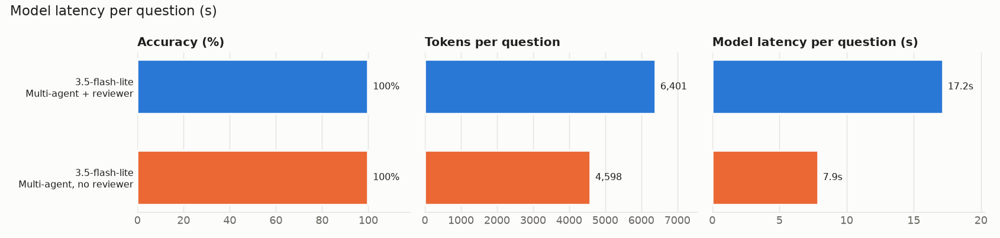

# Experiment results

51 graded runs over 35 questions (gemini-3.5-flash-lite). Generated by `python -m eval.report` from `results/runs.jsonl`.

- **accuracy** - the one-line answer matched the reference answer (deterministic grader, `eval/grader.py`)
- **runs_with_self_correction** - runs where at least one script failed and the agent fixed it
- **runs_revised_by_reviewer** - runs where the reviewer asked for at least one revision
- **avg_llm_latency_s** - summed model response time per question; time queued by the client-side rate limiter (free tier: 15 requests/min) is excluded
- **avg_cost_usd** - estimate from the `analyst/config.py` price table (the free tier was actually used)

## Hinted suite

Questions as written: cleaning rules that change the answer are stated in the question.

| model                 | variant     |   runs |   accuracy_pct |   completed_pct |   avg_executions |   runs_with_self_correction |   runs_revised_by_reviewer |   avg_llm_calls |   avg_tokens |   avg_cost_usd |   avg_llm_latency_s |
|:----------------------|:------------|-------:|---------------:|----------------:|-----------------:|----------------------------:|---------------------------:|----------------:|-------------:|---------------:|--------------------:|
| gemini-3.5-flash-lite | multi       |     35 |         100.00 |          100.00 |             1.00 |                           0 |                          0 |            4.00 |      6401.37 |           0.00 |               17.19 |
| gemini-3.5-flash-lite | no_reviewer |     16 |         100.00 |          100.00 |             1.06 |                           1 |                          0 |            3.06 |      4598.06 |           0.00 |                7.89 |

Accuracy by dataset (%):

| model                 | variant     |   hr_employees.xlsx |   sales.csv |   support_tickets.csv |   web_traffic.csv |
|:----------------------|:------------|--------------------:|------------:|----------------------:|------------------:|
| gemini-3.5-flash-lite | multi       |                 100 |         100 |                   100 |               100 |
| gemini-3.5-flash-lite | no_reviewer |                 nan |         100 |                   nan |               100 |

Incorrect answers:

None.
